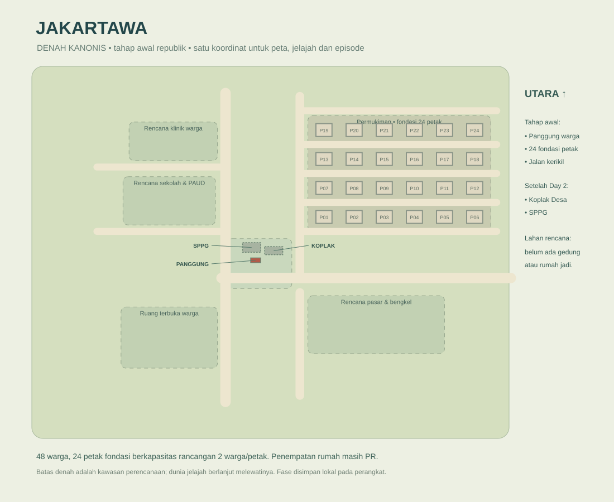
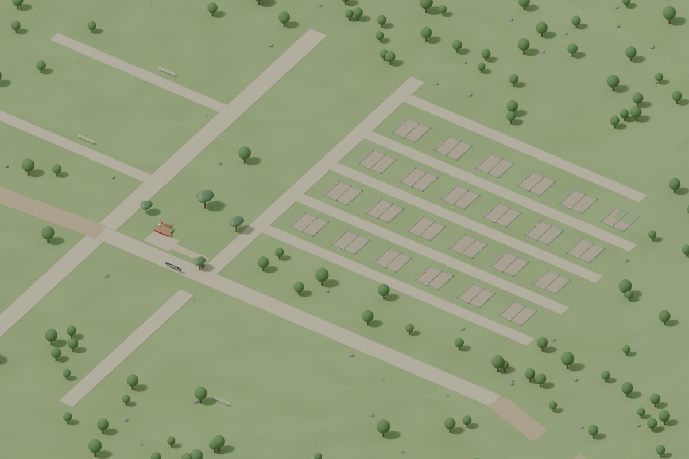
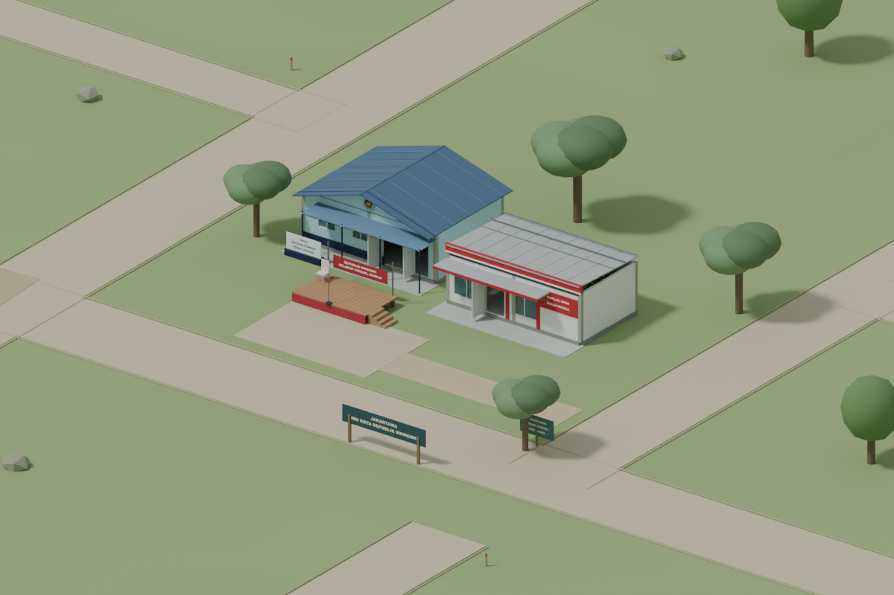
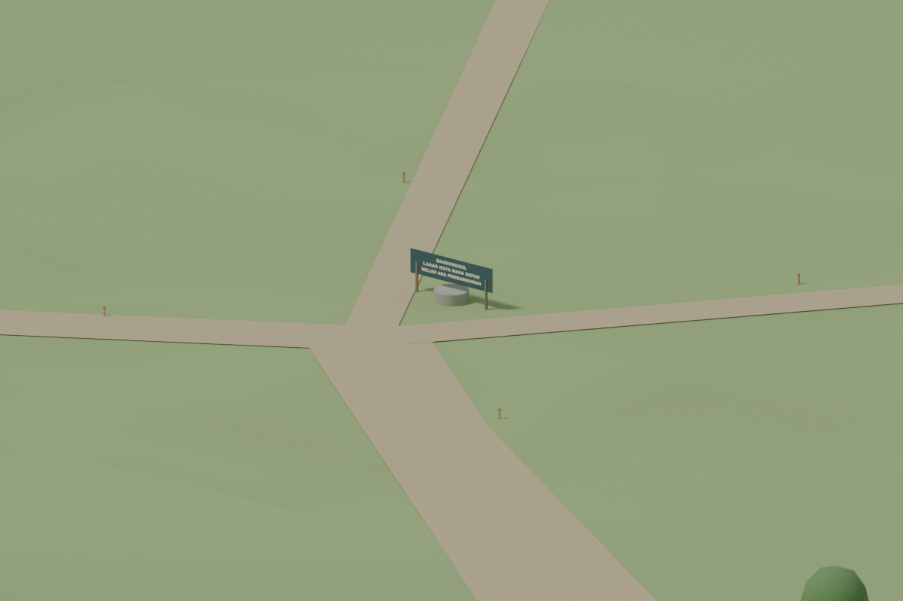
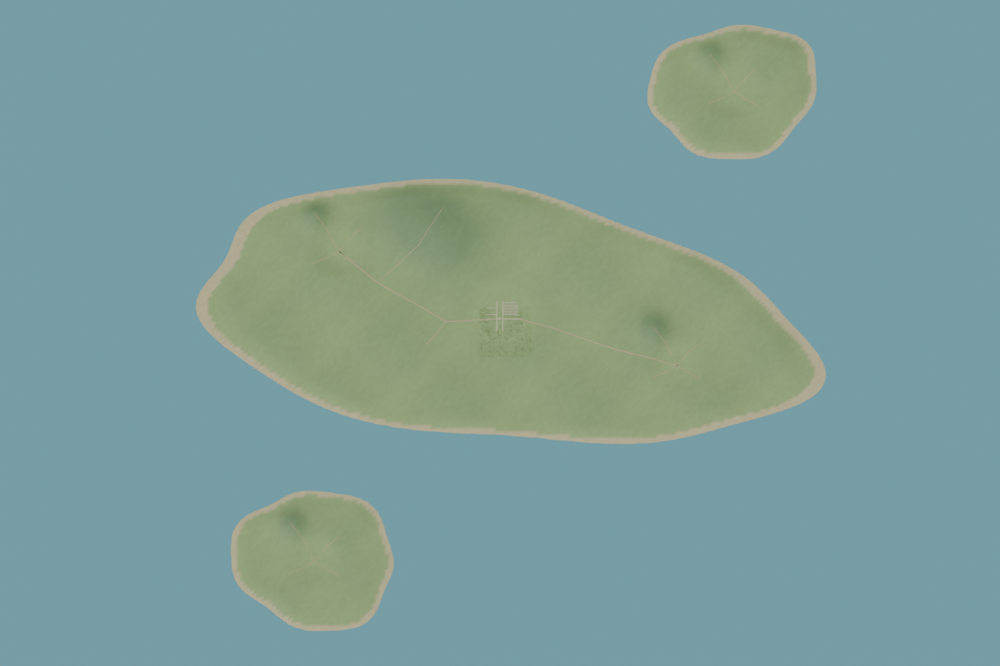

# Jakartawa: dunia dan urutan pembangunan

Nama ibu kota kini **Jakartawa**. Nama berkas ini dipertahankan agar tautan dokumentasi lama tidak putus. Kota lain adalah **Bandunggul**, **Surabawow**, **Semarame**, dan **Makasabar**; ID `jakarta`, `bandung`, `surabaya`, `semarang`, dan `makassar` tetap menjadi kunci penyimpanan/API.

Peta nasional, roadmap regional, denah ibu kota, dunia jelajah, serta latar episode memakai koordinat yang sama dari `game-src/republic-world-layout.js`. Jakartawa, Bandunggul dan Surabawow berada pada **satu daratan utama**; Semarame dan Makasabar masing-masing berada di pulau terpisah. Polygon `WORLD_LANDMASSES` pada atlas diturunkan dari garis pantai terrain yang sama, bukan gambar peta terpisah.

Tahap awal (`before-day2`) memiliki panggung sementara, jalan kerikil, 24 petak fondasi di timur?timur laut, serta patok lahan rencana. Petak belum menjadi rumah. Rencana kapasitasnya dua warga per petak; pembagian rumah, bangunan hunian, sekolah, klinik, pasar dan bengkel tetap pekerjaan berikutnya. Empat kota lain berupa lahan dengan penanda nama, tanpa kota jadi.

Setelah Day 2 (`after-day2`), Koplak Desa di `[4,0,-7]` dan SPPG di `[-7,0,-9]` selesai. Keduanya mempunyai pintu yang benar-benar dapat dilalui, lantai, rak/gerai dan dapur. Panggung tetap di `[-5,0,-1]`, permukaannya setinggi 0,6 meter dan dapat dicapai melalui empat anak tangga.

**Jelajah publik tidak memuat episode, pemutar, audio produksi atau kontrol studio.** Produksi hanya berada pada halaman admin. Bangunan, panggung dan terrain dipakai bersama melalui modul geometri netral `republic-civic-center.js`, `republic-civic-buildings.js` dan `republic-geometry.js`; modul public tidak mengimpor `production-*`. Pembuatan episode di admin memakai geometri tersebut dengan urutan konstruksi per komponen.

Fase disimpan **lokal pada perangkat/browser**, bukan kemajuan global server. Selesainya pemutaran Day 2 kanonis pada admin dapat memajukan fase; membuka daftar episode atau melompat langsung ke akhir tidak dianggap pembangunan otomatis. Perubahan fase melalui event `republic:world-phase` menyelaraskan denah, minimap dan dunia. Pilihan fase untuk inspeksi tidak menyiratkan perubahan pada semua pemain.

## Kawasan dan perjalanan

`getRegionalLayout(cityId)` mengembalikan viewport wilayah kota terpilih, bukan seluruh atlas nasional. Setiap wilayah mempunyai lima jenis kawasan: urban, desa, pedesaan, hutan, dan pegunungan. Pada empat kota luar, desa masih rencana tanpa rumah; hutan dan bukit merupakan bentang alam yang bisa dijelajahi. Semua titik masuk memakai koordinat global. `WORLD_DISTRICTS` dan `WORLD_ROUTES` menjadi sumber geometri yang sama untuk label, patok, vegetasi dan jalan setapak lokal.

Wilayah Jakartawa memuat **Desa Sukausul**, **Padang Santai**, **Hutan Bisik-Bisik** dan **Bukit Banyakjanji**. Lahan desa baru ditandai patok, padang tetap terbuka, hutan mempunyai vegetasi lebih rapat, dan pegunungan memiliki relief nyata. Jalan Barat/Timur menghubungkan tiga kota pada daratan utama; jalan setapak bercabang ke desa, hutan dan bukit. Jalur tersebut mengikuti ketinggian tanah, bukan jalan melayang di atas laut. Pulau terpisah dapat dimasuki melalui tujuan peta; belum ada kapal atau jembatan antarpulau.

- WASD/panah untuk berjalan, Shift untuk berlari dan seret untuk memutar kamera. Zoom tersedia melalui tombol **+ / ?** yang selalu terlihat, tombol keyboard +/?, gulir, atau cubit layar. Jarak kamera dibatasi 2,2?24 meter; tombol yang mencapai batas dinonaktifkan. Sentuh menggunakan joystick dan tombol tahan LARI.
- Ke-48 pemeran warga berkumpul hanya dalam episode Produksi. Di jelajah publik, Pasca Bowow adalah NPC yang disengaja; warga lain yang terlihat adalah akun yang benar-benar sedang online dan berada dekat pemain pada koordinat dunia yang sama. Posisi disinkronkan berkala melalui API, dan dua warga yang berdekatan dapat mengobrol. **Nama muncul secara kontekstual:** hanya karakter dalam jarak kamera 12 meter, di bagian tengah layar, tidak tertutup tembok, dan maksimal empat label sekaligus. Tidak ada garis penunjuk panjang. Mendekat lalu menekan E membuka obrolan dengan pemain atau kartu NPC; nama avatar sendiri tidak menutupi layar.
- Pemain menggunakan avatar akun aktif; perubahan avatar memperbarui karakter. Ciri aksesori profesi mengikuti `presetId` yang sama dengan studio karakter.
- Terrain detail terdiri dari 25 chunk berukuran 64 meter di sekitar pemain. Chunk yang jauh dilepas; pejalan dapat melewati batas denah perencanaan dan terus berjalan di daratan sampai pantai alami. Pemilihan kota hanya menentukan titik masuk, bukan membuat salinan kota terpisah.
- Tembok, batang pohon, batu, lantai dan tangga memiliki benturan. Kamera memendek saat terhalang bangunan. Dialog dan editor avatar menghentikan input berjalan sementara.
- Kartu warga merupakan karakter cerita lokal; tidak mengirim pesan ke orang lain atau menyatakan bahwa warga sedang daring.

## Identitas bangunan dan referensi

Koplak mempertahankan fasad memanjang, kaca, ventilasi gelap dan kanopi dari acuan gerai Kopdes; lis dan papan nama sekarang menonjolkan **merah?putih**. Acuan arsitektur/interior terperinci tercatat di [konsep Day 2](../script/002-day-2-concept.md#acuan-visual-dua-gedung). Warna ini merupakan adaptasi karakter gerai, bukan rekonstruksi terukur satu gedung.

SPPG memakai dinding **biru pastel**, lis/kolom **navy** dan atap biru abu sesuai arah visual terbaru. Bentuk atap pelana, kanopi dan dapur mengikuti [foto resmi Kementerian PU, SPPG Tanuharjo](https://sda.pu.go.id/balai/bbwsserayuopak/berita/menteri-pu-kunjungi-gedung-satuan-pelayanan-pemenuhan-gizi-dukung-pemenuhan-gizi-di-kab-kebumen). Foto tersebut menunjukkan bangunan putih dengan lis merah; perubahan ke biru adalah keputusan desain proyek, bukan klaim bahwa semua SPPG memakai warna biru.

Lambang **BGN** menggunakan berkas asli dari [situs BGN](https://www.bgn.go.id/logo-bgn.png), bukan gambar ulang. Palet resmi navy `#071e49` dan biru pastel `#b5e0ea` diperiksa pada [arti logo BGN](https://www.bgn.go.id/logo-meaning), 22 November 2026. Aset persis tersimpan di `game-src/assets/bgn-logo-official.png` dan salinan referensi `public/assets/references/bgn/logo-bgn-official.png`. Nama bangunan cerita tetap Satuan Pengisi Perut Gratis; tidak ada klaim kemitraan resmi. Texture memiliki siklus hidup scene sendiri dan dipramuat sebelum ekspor produksi.

## Verifikasi

`node tools/test_republic_world.mjs` memeriksa fase dan seek balik, 48 identitas + presiden, pintu/tangga, benturan, tiga daratan yang sinkron dengan atlas, semua 21 jalur tetap di darat, lima wilayah lokal masing-masing berisi lima jenis kawasan, global city anchors, batas zoom, kondisi label, lubang terrain produksi, pelepasan chunk dan anggaran geometri. UI peta dan pemisahan public/admin memiliki uji tersendiri.

Pratinjau offline: `node tools/review_republic_world.mjs C:/tmp/republic-world-review-v2`, lalu Blender `--background --python tools/review_republic_world.py -- C:/tmp/republic-world-review-v2`. Hasil menggunakan geometri dan tekstur runtime yang sebenarnya. Verifikasi ini tidak diklaim sebagai pengujian interaksi WebGL di browser.

